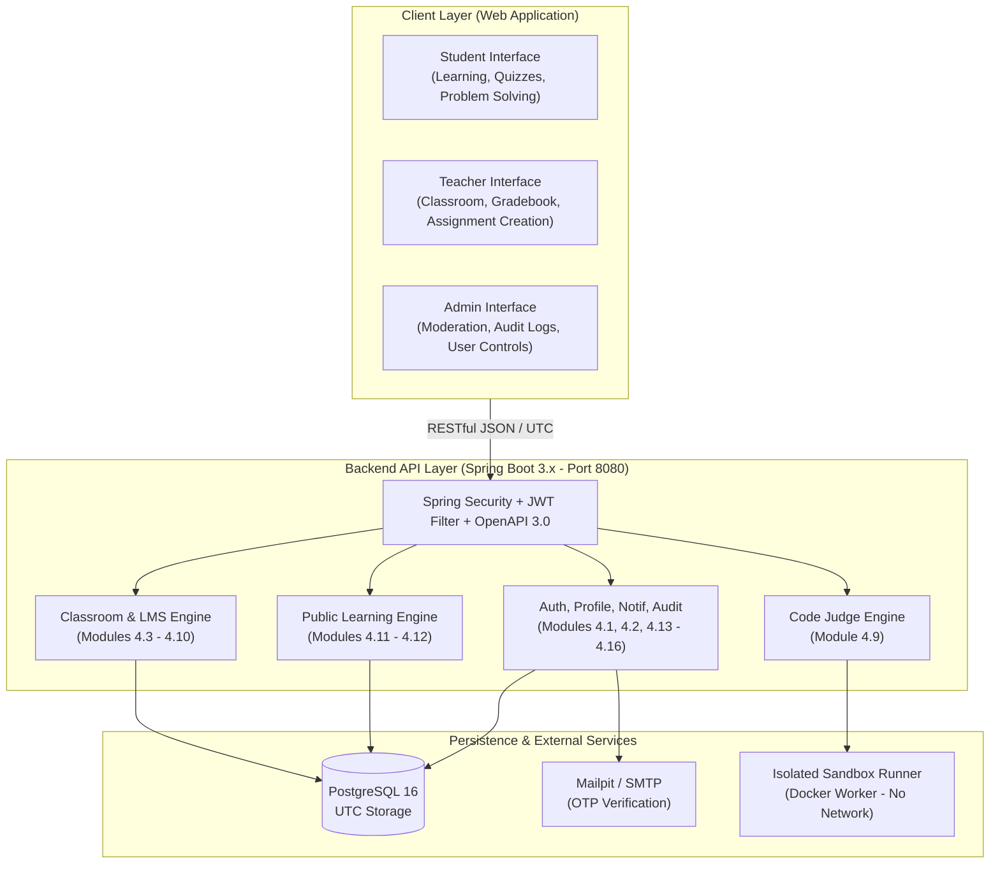
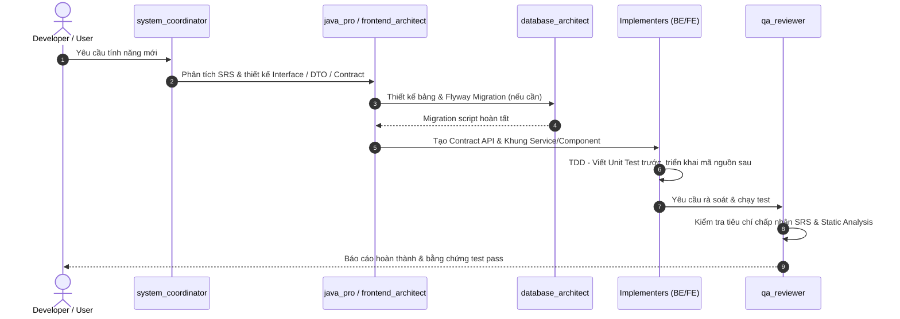

# AlgoLearner - Multi-Agent Engineering & Project Guidelines

> **Single Source of Truth** dành cho các Autonomous AI Agents, Subagents và Kỹ sư phần mềm phát triển nền tảng **AlgoLearner**.  
> Mọi hành động lập trình, thiết kế kiến trúc, sinh mã và kiểm thử trong repository này bắt buộc phải tuân theo các chỉ dẫn dưới đây.

---

## 1. Định Vị Dự Án & Phạm Vi Hệ Thống (Project Context & Scope)

**AlgoLearner** là nền tảng học và luyện tập lập trình toàn diện, kết hợp hai mô hình cốt lõi theo đặc tả **SRS ver 1.1** (chuẩn Karl Wiegers):

### Các Tài Liệu Quy Chuẩn Bắt Buộc Phải Đọc
Trước khi thực hiện bất kỳ thay đổi nào, Agents phải tham chiếu các tài liệu chuẩn sau:
1. [**SRS ver 1.1.docx**](file:///home/hien/Project/AlgoLearner/docs/SRS%20ver%201.1.docx): Đặc tả yêu cầu chức năng (FR), quy tắc nghiệp vụ (BR) và tiêu chí chấp nhận (AC).
2. [**API Design Guidelines**](file:///home/hien/Project/AlgoLearner/docs/rules/API_DESIGN_GUIDELINES.md): Chuẩn RESTful `/api/v1`, định dạng Envelope (`ApiResponse`, `PageResponse`, `ApiErrorResponse`), chuẩn thời gian **ISO-8601 UTC**.
3. [**Coding Standards**](file:///home/hien/Project/AlgoLearner/docs/rules/CODING_STANDARDS.md): Quy chuẩn phân tầng Spring Boot, JPA Entity không dùng `@Data`, strict TypeScript, TanStack Query key factory.
4. [**Security & Sandbox Rules**](file:///home/hien/Project/AlgoLearner/docs/rules/SECURITY_AND_SANDBOX_RULES.md): Ràng buộc bảo mật Sandbox, kiểm soát quyền RBAC/IDOR, chống SQLi/XSS.

---

## 2. Bản Đồ 16 Phân Hệ Nghiệp Vụ SRS (16 SRS Modules Mapping)

Mọi code backend và frontend phải được đặt đúng package/feature tương ứng với 16 phân hệ trong Mục 4 của SRS:

| Phân hệ SRS | Tên Module & Chức năng cốt lõi | Package Backend (`com.algolearner.platform.`) | Feature Frontend (`src/features/`) |
| :--- | :--- | :--- | :--- |
| **4.1** | **Quản lý tài khoản & Xác thực**: Đăng ký, đăng nhập, JWT, xác thực OTP qua email (hết hạn 5 phút). | `auth/` | `auth/` |
| **4.2** | **Hồ sơ cá nhân & Dashboard**: Thông tin người dùng, cài đặt riêng tư, dashboard theo role. | `user/`, `profile/` | `dashboard/` |
| **4.3** | **Quản lý lớp học**: Tạo lớp, Class Code, quản lý thành viên, duyệt tham gia, chuyển quyền sở hữu. | `classroom/` | `classroom/` |
| **4.4** | **Thông báo lớp học**: Đăng thông báo trong lớp, ghim bài viết, phát thông báo. | `announcement/` | `classroom/announcements/` |
| **4.5** | **Bài học trong lớp**: Soạn thảo nội dung bài giảng, tài liệu đính kèm, đánh dấu hoàn thành. | `lesson/` | `classroom/lessons/` |
| **4.6** | **Bài tập trong lớp**: Bài tập tự luận/file/code, deadline, gia hạn, nộp bài nhiều lần. | `assignment/` | `classroom/assignments/` |
| **4.7** | **Bài kiểm tra trắc nghiệm**: Tạo quiz, ngân hàng câu hỏi, giới hạn thời gian, tự động lưu (autosave), chấm điểm tự động. | `quiz/` | `classroom/quizzes/` |
| **4.8** | **Luyện tập code trong lớp**: Bài toán lập trình nội bộ lớp, không giới hạn lượt chạy, tính hoàn thành khi `ACCEPTED`. | `practice/` | `classroom/practice/` |
| **4.9** | **Chấm mã nguồn tự động (Code Judge)**: Biên dịch & chạy Java/Python, giới hạn RAM/CPU/Time, snapshot testcase, rejudge. | `judge/` | Tích hợp trong Problem Editor |
| **4.10** | **Sổ điểm & Đánh giá**: Bảng điểm tổng hợp lớp học, trọng số thành phần, ghi đè điểm (override), xuất bảng điểm. | `grading/` | `classroom/gradebook/` |
| **4.11** | **Khóa học công khai**: Khám phá khóa học mở, lộ trình học tập, theo dõi tiến độ công khai. | `course/` | `course/` |
| **4.12** | **Luyện tập lập trình công khai**: Kho bài LeetCode-style, lọc theo độ khó/chủ đề, streak, submission history, editorial. | `problem/` | `practice/` |
| **4.13** | **Thông báo trong ứng dụng**: Cảnh báo deadline, nhắc nhở streak, kết quả chấm rejudge, thay đổi trong lớp. | `notification/` | `notification/` |
| **4.14** | **Quản trị hệ thống (Admin)**: Duyệt bài đóng góp, khóa/mở tài khoản, quản trị vi phạm, cấu hình hệ thống. | `admin/` | `admin/` |
| **4.15** | **Báo cáo & Xuất dữ liệu**: Xuất dữ liệu học tập ra CSV/Excel, biểu đồ thống kê kết quả học tập. | `report/` | `classroom/reports/` |
| **4.16** | **Kiểm toán & Ghi nhật ký (Audit Log)**: Ghi vết hành động nhạy cảm (admin lock, teacher đổi điểm, rejudge). | `audit/` | `admin/audit-logs/` |

---

## 3. Phân Vai & Trách Nhiệm Của Các Subagent Trong AlgoLearner

Hệ thống tích hợp **22 Subagents** chuyên biệt định nghĩa tại [`.agents/agents.toml`](file:///home/hien/Project/AlgoLearner/.agents/agents.toml). Khi phân rã công việc (task dispatching), các subagents phải đảm nhận đúng vai trò và tuân thủ các quy tắc sau:

### 3.1. Nhóm Backend & Dữ Liệu
* **`java_pro`** (Lead Backend Developer):
  - Chịu trách nhiệm toàn bộ mã nguồn tại `backend/src/main/java/com/algolearner/platform/`.
  - **Quy tắc bắt buộc**: 
    1. Không bao giờ dùng `@Data` trên JPA Entity.
    2. 100% quan hệ JPA phải là `FetchType.LAZY`.
    3. Mọi Service method phải phân định rõ `@Transactional(readOnly = true)` và `@Transactional`.
    4. Không trả về JPA Entity ra ngoài Controller; bắt buộc chuyển đổi sang DTO qua MapStruct hoặc Mapper.
    5. Viết unit test bằng JUnit 5 & Mockito cho mọi Service logic.
* **`database_architect`** (Database & Migration Specialist):
  - Thiết kế ERD và viết file Flyway migration (`backend/src/main/resources/db/migration/V*.sql`).
  - **Quy tắc bắt buộc**: Khóa chính UUID cho bảng nghiệp vụ, BIGSERIAL cho bảng log. Bắt buộc có cột `created_at` và `updated_at` (UTC). Đặt index cho toàn bộ các cột Foreign Key.

### 3.2. Nhóm Sandbox & Security
* **`security_auditor` & `redteam_security`**:
  - Chịu trách nhiệm audit module `judge/` và các cơ chế cô lập container.
  - **Quy tắc bắt buộc**: 
    1. Xác minh rằng mã nguồn Java/Python của người dùng **không bao giờ** chạy trực tiếp trên máy chủ chủ (host).
    2. Cờ thực thi sandbox bắt buộc: `--network none`, `--memory 256m`, `--cpus 1.0`, `--pids-limit 32`, `--cap-drop=ALL`.
    3. Kiểm tra lỗ hổng IDOR trên mọi API quản lý lớp học: xác minh `teacher_id` của lớp học khớp với người dùng đang đăng nhập trước khi cho phép sửa/xóa.
    4. Xác minh rằng mã OTP có hạn dùng chính xác 5 phút và bị vô hiệu hóa ngay sau khi sử dụng.

### 3.3. Nhóm Frontend & UI/UX
* **`frontend_architect` & `frontend_developer`**:
  - Chịu trách nhiệm toàn bộ mã nguồn tại `frontend/src/`.
  - **Quy tắc bắt buộc**: 
    1. TypeScript bật chế độ nghiêm ngặt; **cấm dùng `any`**.
    2. Tách module theo feature (`frontend/src/features/`).
    3. Mọi lời gọi API phải dùng `ApiResponse<T>` từ [`types/api.ts`](file:///home/hien/Project/AlgoLearner/frontend/src/types/api.ts).
    4. Dùng TanStack Query v5 kèm Query Key Factory cho server-state.
    5. Tích hợp Monaco Editor có debounce và phím tắt chuẩn (`Ctrl+Enter` chạy thử code).
* **`taste_craftsman` & `ui_ux_designer`**:
  - Chăm sóc trải nghiệm thị giác, kiểu chữ và khả năng tiếp cận.
  - **Quy tắc bắt buộc**: Đạt chuẩn WCAG 2.2 AA (contrast >= 4.5:1, `aria-label` đầy đủ). Thiết kế layout tập trung (Focus Mode) khi làm Quiz và giải bài lập trình. Tránh các giao diện template AI generic (anti-slop).

### 3.4. Nhóm Đảm Bảo Chất Lượng (QA & Release)
* **`qa_reviewer`**:
  - Rà soát code theo 2 trục: **Tính đúng đắn nghiệp vụ đối chiếu với SRS** và **Chất lượng kỹ thuật (Clean Code, An toàn dữ liệu)**.
  - Đối chiếu trực tiếp với các Tiêu chí chấp nhận (Acceptance Criteria - AC) trong SRS (ví dụ: AC-01..AC-xx của Module 4.9 và 4.7).
* **`devops_engineer`**:
  - Quản lý `docker/docker-compose.yml`, các Dockerfile cho môi trường local (PostgreSQL, Mailpit, Redis, Judge Worker).

---

## 4. Các Bất Biến Nghiệp Vụ Cấm Vi Phạm (Critical Business Invariants)

Bất kỳ AI Agent nào khi tạo hoặc sửa code phải bảo đảm các quy tắc nghiệp vụ sau không bao giờ bị phá vỡ:

1. **Quy tắc Múi Giờ**:
   - Mọi mốc thời gian lưu trong DB và truyền qua API JSON phải là chuỗi **ISO-8601 UTC** kết thúc bằng `Z` (ví dụ: `2026-10-25T14:30:00Z`).
   - Frontend hiển thị thời gian cho người dùng tại Việt Nam theo múi giờ **UTC+7**.
2. **Quy tắc Phân Biệt RUN vs SUBMIT**:
   - `RUN` (Chạy thử): Chỉ chạy trên tập Sample Testcases, phản hồi ngay lập tức, **tuyệt đối không lưu vào bảng bài nộp chính thức**, áp giới hạn 5 lần/phút.
   - `SUBMIT` (Nộp bài): Đưa vào hàng đợi chấm trên toàn bộ Hidden Testcases, lưu bản ghi vào `tbl_submission`, snapshot toàn bộ testcase tại thời điểm nộp.
3. **Quy tắc Làm Bài Trắc Nghiệm (Quiz Autosave & Timers)**:
   - Bài quiz có tính giờ phải hỗ trợ **Autosave** đáp án từng câu hỏi độc lập.
   - Khi hết giờ (Time expired), hệ thống tự động khóa và chấm điểm các câu trả lời đã lưu, không cho phép gửi thêm đáp án mới.
4. **Quy tắc Quyền Riêng Tư Của Sinh Viên**:
   - Sinh viên **chỉ được xem điểm số và bài nộp của chính mình**.
   - Bảng xếp hạng hoặc danh sách lớp chỉ hiển thị thông tin khi có sự cho phép hoặc theo cấu hình công khai của giáo viên.
5. **Quy tắc Tài Khoản Admin**:
   - Tài khoản Admin là cố định (bootstrap qua cấu hình hệ thống), không hỗ trợ tự đăng ký qua giao diện công khai.
   - Admin chỉ hoạt động trên giao diện quản trị riêng, không mang đồng thời vai trò Teacher hoặc Student trong cùng một ngữ cảnh lớp học.

---

## 5. Quy Trình Phát Triển Một Tính Năng (Step-by-Step Feature Workflow)

Mỗi khi nhận yêu cầu phát triển một tính năng mới (ví dụ: Tạo bài tập trong lớp, Nộp bài code):

1. **Bước 1 (SRS Check)**: Đọc mục tương ứng trong Section 4 của [SRS ver 1.1.docx](file:///home/hien/Project/AlgoLearner/docs/SRS%20ver%201.1.docx) để lấy đúng mã FR, BR và Acceptance Criteria.
2. **Bước 2 (API & Contract First)**: Định nghĩa DTO Request/Response và OpenAPI annotations theo [API_DESIGN_GUIDELINES.md](file:///home/hien/Project/AlgoLearner/docs/rules/API_DESIGN_GUIDELINES.md).
3. **Bước 3 (Database Migration)**: Nếu có thay đổi bảng, tạo file migration Flyway mới `V{timestamp}__{description}.sql`.
4. **Bước 4 (TDD Implementation)**: Viết test case trước (`*Test.java` hoặc `*.test.tsx`), sau đó viết code triển khai thỏa mãn test.
5. **Bước 5 (Verification)**: Chạy test và xác nhận kết quả thành công trước khi kết thúc tác vụ.

---

## 6. Giao Thức Tối Ưu Hóa Token (Token Optimization Protocol)

Tất cả các Agents phải tuân thủ nghiêm ngặt kỹ năng tiết kiệm token:
* Sử dụng `grep`, `head`, `sed`, `awk` hoặc precision slicing (chỉ đọc các dòng cần thiết) thay vì đọc nguyên file hàng nghìn dòng.
* Không in lại toàn bộ file mã nguồn trong câu trả lời nếu chỉ chỉnh sửa một vài hàm.
* Trả lời trực diện, súc tích, lược bỏ các câu chào hỏi rườm rà (zero-fluff).
