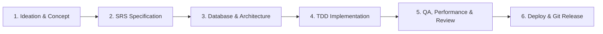

# Multi-Stack Engineering, Security & Agent Workflow Guidelines

> Single Source of Truth for Autonomous AI Coding Agents, Subagents, and Multi-Stack Engineering.

---

## 1. The Complete End-to-End SDLC Lifecycle

Every software initiative managed in this workspace follows a deterministic 6-stage lifecycle:

---

## 2. The 22 Subagents Roster (`agents.toml`)

1. **`system_coordinator`**: High-level orchestrator, SRS author, ticket creator.
2. **`database_architect`**: ERD modeler, DDL designer, zero-downtime migration planner.
3. **`devops_engineer`**: Docker containerization, CI/CD pipelines, Git conflict resolution.
4. **`frontend_architect`**: Component hierarchy, state design, execution planning.
5. **`ui_ux_designer`**: Color harmony, typography, accessibility (WCAG AA), UI tokens.
6. **`taste_craftsman`**: Anti-slop visual art direction, typography, distinctive character.
7. **`frontend_developer`**: Production React/TypeScript/Tailwind implementation.
8. **`qa_reviewer`**: Two-axis code review, accessibility audit, pre-completion verification.
9. **`web_performance_auditor`**: Core Web Vitals, bundle optimization, runtime profiling.
10. **`java_pro`**: Java/Spring Boot development, Maven/Gradle, JVM performance.
11. **`python_backend`**: Python clean architecture, Pydantic v2, pytest suites.
12. **`security_auditor`**: Threat modeling (STRIDE), attack trees, SAST, content sanitization.
13. **`ai_engineer`**: RAG pipelines, LLM prompt regression evals, vector DB ops.
14. **`cloud_architect`**: Terraform IaC, Cloudflare edge compute, Supabase, Kubernetes.
15. **`sre_specialist`**: Datadog APM tracing, Prometheus metrics, SLO error budgets, postmortems.
16. **`mobile_dev`**: React Native, Expo Router v3, EAS CI/CD, offline synchronization.
17. **`load_tester`**: k6 concurrency benchmarks, Locust load clusters, chaos resilience.
18. **`data_scientist`**: DuckDB, Polars lazy frames, dbt data modeling, PyTorch training.
19. **`redteam_security`**: Penetration testing, OWASP Top 10 mitigation, container escape defense.
20. **`systems_engineer`**: Rust, WebAssembly, modern C/C++ memory safety, Linux eBPF tracing.
21. **`graphics_web_dev`**: Three.js WebGL 3D, WebRTC real-time media, Framer Motion, Tauri.
22. **`cloud_platform_lead`**: Multi-cloud AWS/GCP/Azure architecture, Karpenter, BigQuery.

---

## 3. 21 Curated Skill Domains (285 Skills Total)
Includes Planning & YC Product Workflows, Clean Architecture, TDD, Design-Taste, Security Threat, Full Stacks, Ops Guardrails, Documents & Media, AI/LLM, Cloud & Serverless (Neon, Cloudflare, Supabase), Testing & Concurrency (k6, Browserbase), Mobile, Streaming Data, SRE, Data/ML Analytics (Hugging Face, DuckDB, Polars), 3D Web & Desktop (Remotion, Three.js), Offensive Red Team, Low-Level Systems, Enterprise AWS/GCP/Azure, Developer Productivity (Google Workspace, Git internals), and Advanced Frontend Mastery (Angular Signals, React 19, Resend).

---

## 4. Central References & Cookbooks Hub (`references/`)
Provides authoritative technical cheat sheets accessible via `agents-kit reference <topic>`:
- `references/frontend/modern-css-cheat-sheet.md` (Subgrid, Container Queries, clamp(), dvh/svh/lvh, @layer)
- `references/frontend/react-19-and-nextjs15-reference.md` (use() hook, useActionState, useOptimistic, slots)
- `references/frontend/tanstack-query-v5-cookbook.md` (Query key factory, optimistic mutations, SSR hydration)
- `references/frontend/wcag-accessibility-audit-checklist.md` (WCAG 2.2 AA audit checklist & ARIA 1.2)
- `references/frontend/design-tokens-and-color-palettes.md` (Oklch color scales, 8pt spacing, shadows)
- `references/frontend/state-management-matrix.md` (Zustand, Jotai, React Context, Signals decision tree)
