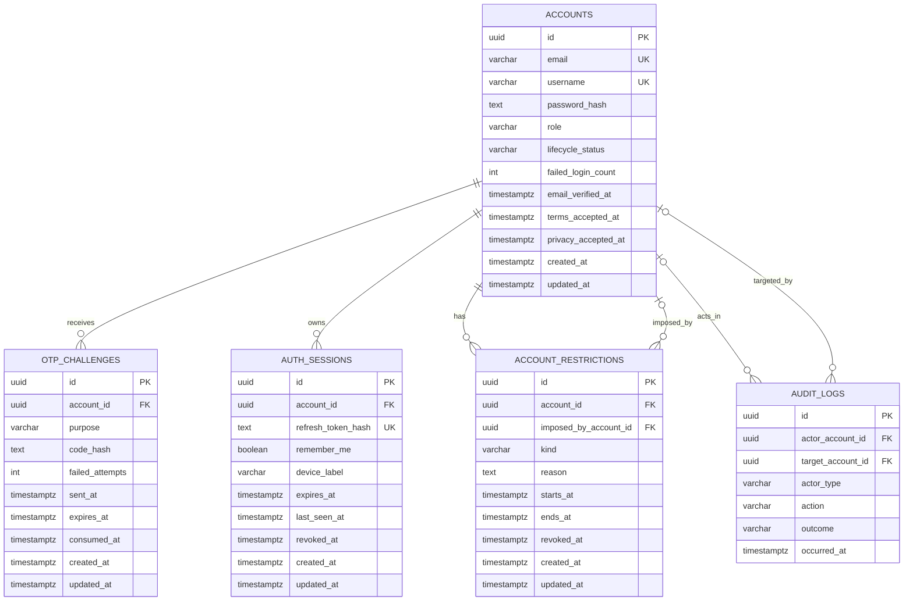

# ERD 4.1 — Quản lý tài khoản và xác thực

Nguồn: `docs/SRS ver 1.1.docx`, mục 4.1 (`FR-ACC-*`, `FR-AUTH-*`) và các quy tắc `BR-ACC-001`–`BR-ACC-016`. Sơ đồ là thiết kế logic cho PostgreSQL, giới hạn ở dữ liệu tài khoản và xác thực. `AUDIT_LOGS` là bảng dùng chung với mục 4.16; ở đây chỉ thể hiện các liên kết cần cho thao tác tài khoản.

## Quy tắc thiết kế

- `ACCOUNTS.role` nhận `STUDENT`, `TEACHER`, `ADMIN`. Đăng ký công khai chỉ tạo `STUDENT` hoặc `TEACHER`; mặc định `STUDENT`. `email` và `username` duy nhất, không sửa sau khi tạo. Việc xác nhận Điều khoản và Chính sách quyền riêng tư được lưu bằng hai mốc thời gian.
- `lifecycle_status` lưu `PENDING_VERIFICATION`, `ACTIVE`, `DEACTIVATED`. Trạng thái hiển thị `TEMPORARILY_LOCKED` hoặc `SUSPENDED` được tính từ hạn chế đang hiệu lực trong `ACCOUNT_RESTRICTIONS`. Như vậy khóa tự động, khóa Admin và đình chỉ không ghi đè lẫn nhau. `kind` nhận `AUTO_LOCK`, `ADMIN_LOCK`, `SUSPENSION`; `reason` bắt buộc với `SUSPENSION`. `imposed_by_account_id` để trống với khóa tự động.
- `failed_login_count` đếm các lần đăng nhập sai liên tiếp. Đến 5 lần, tạo `AUTO_LOCK` có `ends_at = starts_at + 15 phút`. Hết hạn khóa tự động không gỡ khóa Admin hoặc đình chỉ còn hiệu lực.
- `OTP_CHALLENGES.purpose` nhận `REGISTER`, `RESET_PASSWORD`. Lưu mã dưới dạng hash; hiệu lực 10 phút, tối đa 5 lần sai. Lần gửi mới phải cách lần trước ít nhất 60 giây. OTP đã dùng hoặc hết hạn không còn hợp lệ.
- `AUTH_SESSIONS` lưu hash của refresh token, một hàng cho mỗi phiên/thiết bị. Hết hạn sau 7 ngày hoặc 30 ngày khi `remember_me = true`; access token JWT có hạn 15 phút và không cần lưu trong bảng. Reset mật khẩu hoặc vô hiệu hóa thu hồi mọi phiên; đổi mật khẩu giữ phiên hiện tại và thu hồi các phiên khác.
- `AUDIT_LOGS` ghi các thao tác quản trị trạng thái tài khoản với actor, target, action, outcome và thời điểm. `actor_account_id` có thể trống với tác nhân hệ thống; `target_account_id` có thể trống khi sự kiện không gắn được với tài khoản đã tồn tại. Không lưu mật khẩu, mã OTP hoặc token trong audit log.
- Các bảng Class, Membership, Submission, Grade và Progress thuộc các mục khác. Thay đổi trạng thái tài khoản không xóa các bản ghi đó; hạn chế truy cập và chế độ chỉ đọc của Class được áp dụng theo `FR-ACC-007`–`FR-ACC-009`.

Các khóa ngoại trỏ tới `ACCOUNTS.id` cần chỉ mục riêng. `created_at` và `updated_at` dùng `TIMESTAMPTZ` UTC; các bản ghi audit là bất biến nên chỉ có `occurred_at`.
