# ERD 4.2 — User Dashboard (Student, Teacher, Admin)

Nguồn: [SRS ver 1.1](../SRS%20ver%201.1.docx), mục 4.2: **FR-PRO-003**, **FR-PRO-004**, **FR-PRO-005**. ERD chung cho Student, Teacher, Admin; xem [user-profile](ERD-4.2-user-profile.md) cho hồ sơ cá nhân.

Đây là **ERD logic các nguồn dữ liệu**, giúp thấy Dashboard lấy thông tin qua quan hệ nào. Không có bảng `user_dashboards`: mỗi thực thể thuộc phân hệ gốc và chỉ được tạo một lần trong database chung. [Bản DBML](ERD-4.2-user-dashboard.dbml) có thể mở độc lập.

`accounts`, `account_restrictions`, `audit_logs` là tham chiếu tới thiết kế 4.1/4.16 có sẵn. Các bảng/cột còn lại là **đề xuất hợp đồng dữ liệu** cho các phân hệ chưa có ERD trong `docs/database`. Chỉ thể hiện phần cột cần cho Dashboard, không phải schema đầy đủ hay DDL có thể chạy. Khi thiết kế từng phân hệ, cần hoàn thiện enum, ràng buộc, index, chính sách xóa và `created_at`/`updated_at` UTC cho bảng nghiệp vụ; không tạo lại bảng chỉ để phục vụ Dashboard. Giữ nguyên UUID của `audit_logs.id` theo ERD account-auth hiện tại; khác biệt với chuẩn BIGSERIAL cho log cần được xử lý tại thiết kế audit dùng chung trước migration.

```mermaid
erDiagram
    ACCOUNTS ||--o{ CLASSROOMS : owner_account_id
    CLASSROOMS ||--o{ CLASSROOM_MEMBERSHIPS : classroom_id
    ACCOUNTS ||--o{ CLASSROOM_MEMBERSHIPS : student_account_id
    CLASSROOMS ||--o{ ASSIGNMENTS : classroom_id
    CLASSROOMS ||--o{ QUIZZES : classroom_id
    ACCOUNTS ||--o{ COURSE_ENROLLMENTS : account_id
    PUBLIC_COURSES ||--o{ COURSE_ENROLLMENTS : course_id
    ACCOUNTS ||--o{ SUBMISSIONS : account_id
    PUBLIC_PROBLEMS o|--o{ SUBMISSIONS : public_problem_id
    ACCOUNTS ||--o{ NOTIFICATIONS : recipient_account_id
    ACCOUNTS o|--o{ PUBLIC_COURSES : contributor_account_id
    ACCOUNTS o|--o{ PUBLIC_PROBLEMS : contributor_account_id
    CLASSROOMS ||--o{ CLASS_PRACTICE_PROBLEMS : classroom_id
    ASSIGNMENTS ||--o{ ASSIGNMENT_SUBMISSIONS : assignment_id
    ACCOUNTS ||--o{ ASSIGNMENT_SUBMISSIONS : student_account_id
    CLASS_PRACTICE_PROBLEMS o|--o{ SUBMISSIONS : class_practice_problem_id
    ASSIGNMENTS o|--o{ SUBMISSIONS : assignment_id
    ACCOUNTS ||--o{ ACCOUNT_RESTRICTIONS : account_id
    ACCOUNTS o|--o{ AUDIT_LOGS : actor_account_id
    ACCOUNTS o|--o{ AUDIT_LOGS : target_account_id
    ACCOUNTS {
        uuid id PK
        varchar role
        varchar lifecycle_status
        timestamptz created_at
    }
    CLASSROOMS {
        uuid id PK
        timestamptz created_at
        uuid owner_account_id FK
        varchar name
        varchar status
    }
    CLASSROOM_MEMBERSHIPS {
        uuid id PK
        timestamptz created_at
        uuid classroom_id FK
        uuid student_account_id FK
        varchar status
    }
    ASSIGNMENTS {
        uuid id PK
        timestamptz created_at
        uuid classroom_id FK
        varchar title
        varchar status
        timestamptz due_at
    }
    QUIZZES {
        uuid id PK
        timestamptz created_at
        uuid classroom_id FK
        varchar title
        varchar status
        timestamptz opens_at
        timestamptz closes_at
    }
    PUBLIC_COURSES {
        uuid id PK
        uuid contributor_account_id FK
        varchar moderation_status
        timestamptz created_at
        varchar title
        varchar status
    }
    COURSE_ENROLLMENTS {
        uuid id PK
        timestamptz created_at
        uuid account_id FK
        uuid course_id FK
        varchar status
    }
    PUBLIC_PROBLEMS {
        uuid id PK
        uuid contributor_account_id FK
        varchar moderation_status
        timestamptz created_at
        varchar title
        varchar difficulty
    }
    SUBMISSIONS {
        uuid id PK
        uuid account_id FK
        uuid class_practice_problem_id FK
        uuid assignment_id FK
        uuid public_problem_id FK
        varchar verdict
        timestamptz submitted_at
    }
    NOTIFICATIONS {
        uuid id PK
        uuid recipient_account_id FK
        varchar title
        timestamptz read_at
        timestamptz deleted_at
        timestamptz created_at
    }
    CLASS_PRACTICE_PROBLEMS {
        uuid id PK
        timestamptz created_at
        uuid classroom_id FK
        varchar title
    }
    ASSIGNMENT_SUBMISSIONS {
        uuid id PK
        timestamptz created_at
        uuid assignment_id FK
        uuid student_account_id FK
        varchar grading_status
        timestamptz submitted_at
    }
    ACCOUNT_RESTRICTIONS {
        uuid id PK
        uuid account_id FK
        varchar kind
        text reason
        timestamptz starts_at
        timestamptz ends_at
        timestamptz revoked_at
    }
    AUDIT_LOGS {
        uuid id PK
        uuid actor_account_id FK
        uuid target_account_id FK
        varchar action
        varchar outcome
        timestamptz occurred_at
    }
```

## Bảng nguồn và quan hệ

| Bảng | Phân hệ sở hữu | Vai trò trong Dashboard |
| :--- | :--- | :--- |
| `accounts` | 4.1 | Xác định tài khoản và vai trò từ dữ liệu xác thực; chỉ tham chiếu khóa, không sao chép email/username/role |
| `classrooms` | 4.3 | Thông tin Class; `owner_account_id` tham chiếu Teacher sở hữu |
| `classroom_memberships` | 4.3 | Quan hệ Student–Class N–N; một hàng trạng thái hiện tại cho mỗi cặp Student/Class |
| `assignments` | 4.6 | Assignment và deadline gốc theo Class |
| `quizzes` | 4.7 | Quiz, thời điểm mở/đóng theo Class |
| `public_courses` | 4.11 | Thông tin Public Course |
| `course_enrollments` | 4.11 | Quan hệ tài khoản–khóa học N–N; xác định khóa đang học |
| `public_problems` | 4.12 | Bài toán Public Practice, độ khó để nhóm thống kê |
| `submissions` | 4.9, tích hợp 4.12 | Official Submission của người dùng; nguồn tính Solved và Streak |
| `notifications` | 4.13 | Thông báo mới nhất theo người nhận |

`submissions.public_problem_id` biểu diễn liên kết logic với Public Practice. Cách liên kết chính thức giữa Submission, Problem và ngữ cảnh Class/Public sẽ được chốt ở 4.9/4.12; cột này không thay thế thiết kế đa ngữ cảnh hoặc snapshot testcase. Không tạo thêm bảng submission dành riêng cho Dashboard.

## Từ nhóm hiển thị đến truy vấn dữ liệu

Mọi truy vấn dùng `current_account_id` từ principal đã xác thực. Không cho client truyền Student ID khác để đổi phạm vi Dashboard. Kiểm tra vai trò Student và quyền truy cập tài khoản trước khi đọc dữ liệu; thiết lập hồ sơ công khai không cấp quyền đọc Dashboard.

| Nhóm theo FR-PRO-003 | Đường quan hệ / điều kiện |
| :--- | :--- |
| Class đang tham gia | `accounts → classroom_memberships → classrooms`; lọc đúng Student, membership được chấp thuận và còn hiệu lực, Class có quyền truy cập |
| Assignment sắp tới | Các Class hợp lệ ở trên `→ assignments`; chỉ bài đã công bố và được phép xem, dùng deadline hiệu lực riêng của Student nếu có gia hạn ở 4.6 |
| Quiz sắp tới | Các Class hợp lệ `→ quizzes`; áp dụng lịch mở/đóng, trạng thái công bố và ngoại lệ của 4.7; không nhầm lịch Quiz với timer của một lượt làm |
| Public Course đang học | `accounts → course_enrollments → public_courses`; đúng tài khoản, trạng thái đang học và còn quyền truy cập; tiến độ lấy từ dữ liệu học tập 4.11 |
| Public Practice Statistics | `accounts → submissions → public_problems`; chỉ Official Submission thuộc Public Practice của chính Student; độ khó lấy từ Problem |
| Streak | Các Official Submission Public Practice Accepted của chính Student, nhóm ngày theo UTC+7 |
| Notification mới nhất | `accounts → notifications`; đúng `recipient_account_id`, bỏ hàng soft-delete/hết retention, sắp xếp mới nhất và giới hạn số lượng |

“Sắp tới” cần tham số khoảng thời gian được định nghĩa trong hợp đồng API khi triển khai; mục 4.2 không ấn định số ngày. Không tự lấy mọi bài trong Class nếu bài chưa công bố hoặc Student không còn quyền truy cập. Bảng gia hạn, tiến độ bài học và lượt làm Quiz không được vẽ đầy đủ ở đây vì do phân hệ nguồn thiết kế; Dashboard vẫn phải áp dụng các quy tắc đó.

Solved là `COUNT(DISTINCT public_problem_id)` trên Official Submission `ACCEPTED` của chính Student, không đếm số lượt Accepted. RUN không sinh hàng Official Submission. Class Practice và Assignment không đóng góp vào Solved/Streak Public Practice.

Ngày Streak được xác định bằng ngày địa phương UTC+7 của timestamp sự kiện nộp bài chính thức, đề xuất dùng `submitted_at`; cần thống nhất cùng phân hệ 4.12 khi xử lý chấm bất đồng bộ/rejudge. Nhiều Accepted trong cùng ngày chỉ tính một ngày. Current Streak giữ chuỗi kết thúc hôm nay hoặc hôm qua khi hôm nay chưa có Accepted; khi đã bỏ lỡ trọn một ngày thì reset. Highest Streak là chuỗi dài nhất. Timestamp gốc vẫn là UTC; phép nhóm ngày dùng UTC+7.

## Ràng buộc và chỉ mục dự kiến

- Khóa chính bảng nghiệp vụ là UUID; không sinh thêm ID người dùng trong Dashboard. FK tài khoản luôn trỏ `accounts.id` có sẵn ở 4.1.
- Unique `(classroom_id, student_account_id)` cho membership hiện tại; `(student_account_id, status)` phục vụ tra Class của Student. Unique `(account_id, course_id)` tránh trùng đăng ký khóa học hiện tại. Nếu cần lịch sử tham gia/rời lớp hoặc tái đăng ký thì phân hệ nguồn thiết kế lịch sử riêng.
- Index các FK: `classrooms.owner_account_id`, `assignments.classroom_id`, `quizzes.classroom_id`; FK membership được phủ bằng các index trong DBML. FK enrollment và submission được phủ bằng index đơn hoặc tiền tố index ghép. Thêm index `(classroom_id, due_at)` hoặc lịch Quiz khi truy vấn thực tế yêu cầu.
- Index `(account_id, submitted_at)` phục vụ thống kê cá nhân, `public_problem_id` phục vụ liên kết bài toán; `(recipient_account_id, created_at)` phục vụ thông báo mới nhất. Tối ưu theo execution plan khi triển khai, không JOIN tất cả các nhánh N–N trong một truy vấn gây nhân bản số đếm.
- Không lưu `solved_count`, `current_streak`, danh sách Class hay bản sao Notification vào `user_profiles`. Không tạo bảng Calendar riêng trong MVP.
- Không trả điểm, bài nộp hoặc dữ liệu học tập riêng tư của Student khác. Liên kết từ Dashboard tới Class/Assignment/Quiz/Course phải tiếp tục kiểm tra quyền ở chức năng đích.

## Truy vết tiêu chí chấp nhận Student — FR-PRO-003

| Tiêu chí | Thiết kế / tình huống cần kiểm chứng khi triển khai |
| :--- | :--- |
| AC-01 | Chỉ Student đã xác thực và đủ quyền được mở Dashboard Student |
| AC-02 | Đủ bảy nhóm hiển thị trong bảng truy vấn, gồm cả thống kê Practice và Streak |
| AC-03 | Membership chờ duyệt, bị từ chối/loại khỏi lớp không cấp quyền xem Class |
| AC-04 | Bài tập/Quiz theo Class có quyền; Course, Practice, Streak đúng Student, kể cả deadline riêng |
| AC-05 | Notification lọc theo người nhận đang đăng nhập |
| AC-06 | Đổi ID từ client không đọc được điểm/bài nộp/Dashboard riêng tư của Student khác |
| AC-07 | Không bổ sung Calendar bắt buộc |

Đây là thiết kế và danh sách kiểm chứng, chưa phải kết quả chạy kiểm thử chức năng hay schema migration đã triển khai.

## Dashboard Teacher — FR-PRO-004

Áp dụng `BR-CLS-001`, `BR-CLS-002` và quy tắc phân quyền Class. Mọi nhánh dữ liệu Class bắt đầu từ `classrooms.owner_account_id = current_account_id`, kiểm tra quyền sở hữu hiện hành và trạng thái Class. Teacher không được xem dữ liệu riêng tư ngoài các Class mình sở hữu.

| Nhóm hiển thị | Nguồn và phạm vi |
| :--- | :--- |
| Class đang quản lý | `classrooms` theo Teacher sở hữu và quyền quản lý còn hiệu lực |
| Assignment đang mở hoặc sắp tới | Class hợp lệ → `assignments`; áp dụng lịch mở, trạng thái công bố, deadline theo 4.6; lịch mở cần hoàn thiện tại schema nguồn |
| Bài nộp chưa chấm | Class → `assignments` → `assignment_submissions`; lọc `grading_status` cần chấm theo 4.6/4.10, chọn lượt nộp theo quy tắc nguồn |
| Submission mới | `submissions → class_practice_problems → classrooms` hoặc `submissions → assignments → classrooms`; đúng Class sở hữu, sắp xếp theo `submitted_at`; bài tự luận/file lấy từ `assignment_submissions` |
| Notification mới nhất | `notifications.recipient_account_id = current_account_id`, áp dụng soft-delete/retention |
| Nội dung Public đóng góp chờ xét duyệt | `public_courses` và `public_problems` theo `contributor_account_id`, lọc `moderation_status` chờ duyệt |
| Thống kê Class | Tổng hợp membership, Assignment, Quiz, bài nộp và kết quả học tập của các Class hợp lệ; điểm chi tiết lấy từ 4.10, không lưu bản sao vào Dashboard |

Các nguồn bổ sung trong ERD chung:

- `class_practice_problems` (4.8): nối bài Practice nội bộ với Class để giới hạn quyền Teacher.
- `assignment_submissions` (4.6): lượt nộp bài tập với Student, thời điểm nộp và trạng thái chấm; không đồng nhất với lần chấm code trong `submissions` (4.9).
- `public_courses.contributor_account_id`, `public_problems.contributor_account_id` và `moderation_status` (4.11/4.12/4.14): hợp đồng đề xuất cho tác giả và xét duyệt. Tác giả NULL có thể dành cho nội dung hệ thống; phân hệ nguồn chốt quy tắc.
- `submissions.class_practice_problem_id`, `submissions.assignment_id`: liên kết logic bổ sung cho ngữ cảnh Class Practice và Assignment code. Mỗi Official Submission phải có đúng ngữ cảnh; CHECK và liên kết chính thức, kể cả snapshot testcase, được hoàn thiện tại 4.9. Không cho bản ghi vô ngữ cảnh chỉ vì các FK đang nullable trong projection.

Không cộng lượt nộp bài tập và lần chấm code thành cùng một chỉ số tùy ý. Không tính mọi lượt nộp cũ thành công việc chưa chấm mới. Student Public Practice cá nhân không xuất hiện trong nhánh Submission của Teacher chỉ vì Student đó có tham gia Class.

| Tiêu chí FR-PRO-004 | Cách đáp ứng / kiểm chứng khi triển khai |
| :--- | :--- |
| AC-01 | Xác thực Teacher và quyền truy cập Dashboard |
| AC-02 | Đủ bảy nhóm thông tin trong bảng trên |
| AC-03–AC-04 | Class, thống kê, Assignment, bài chưa chấm và Submission mới chỉ thuộc Class Teacher sở hữu |
| AC-05 | Notification đúng người nhận; đóng góp chờ duyệt đúng Teacher |
| AC-06 | Thay ID không đọc được Class của Teacher khác hay dữ liệu ngoài phạm vi |
| AC-07 | Chức năng đích tiếp tục kiểm tra quyền, kể cả khi Class vừa chuyển chủ sở hữu |

## Dashboard Admin — FR-PRO-005

Áp dụng `BR-ADM-001`, `BR-ADM-002`, `BR-ADM-004`, `BR-ADM-005` và quyền Audit tương ứng. Chỉ Admin đủ quyền được truy vấn; Student/Teacher bị từ chối trước khi đọc dữ liệu quản trị. Admin hoạt động trong ngữ cảnh quản trị riêng.

| Nhóm hiển thị | Nguồn và phép tổng hợp |
| :--- | :--- |
| Tổng Student | `accounts` lọc `role = STUDENT` |
| Tổng Teacher | `accounts` lọc `role = TEACHER` |
| Tổng Class | `classrooms` theo bộ lọc trạng thái được định nghĩa |
| Tổng Public Course | `public_courses`, xác định rõ tổng nội dung hay chỉ nội dung đã xuất bản |
| Tổng Public Practice Problem | `public_problems`, không gộp bài Class Practice |
| Tổng Submission | `submissions` chính thức trên các ngữ cảnh; không tính RUN hay lượt nộp file/tự luận |
| Nội dung Teacher đóng góp chờ duyệt | `public_courses`/`public_problems` theo trạng thái chờ duyệt, JOIN tác giả có Role Teacher |
| Tài khoản bị khóa hoặc vi phạm | `accounts` + `account_restrictions` + dữ liệu quản trị/audit liên quan; đánh giá `starts_at`, `ends_at`, `revoked_at`, phân biệt khóa và đình chỉ |
| Hoạt động gần đây của hệ thống | Sự kiện nghiệp vụ của các phân hệ và `audit_logs`; audit không mặc nhiên chứa mọi hoạt động hệ thống |
| Audit quan trọng | `audit_logs` theo `action`, `outcome`, `occurred_at` và quyền; nhóm action quan trọng được chốt tại 4.16 |
| Lối tắt cấu hình hệ thống | Điều hướng tới 4.14, tiếp tục kiểm tra quyền thao tác; không cần bảng lối tắt |
| Biểu đồ thống kê theo thời gian | `accounts.created_at`, `classrooms.created_at`, `public_courses.created_at`, `public_problems.created_at`, `submissions.submitted_at`, `audit_logs.occurred_at` tùy chỉ số |

`accounts.role`, `lifecycle_status`, `created_at` chỉ là các cột tham chiếu có sẵn ở 4.1. `account_restrictions` và `audit_logs` cũng được dùng lại, không tạo bảng mới. Thông tin vi phạm chi tiết ngoài lý do hạn chế và sự kiện Audit cần lấy từ 4.14; schema xử lý vi phạm được hoàn thiện trong phân hệ đó. Không coi mọi khóa tự động là vi phạm đã được xác nhận.

Hợp đồng thống kê phải xác định có bao gồm tài khoản chờ xác thực/vô hiệu hóa, Class lưu trữ hay nội dung chưa xuất bản không. Các truy vấn tổng hợp từng nhánh trước khi JOIN; tài khoản có nhiều hạn chế vẫn chỉ được đếm một lần trong số tài khoản khóa.

Biểu đồ đề xuất thể hiện **số phát sinh trong khoảng thời gian**. Thời điểm tạo không tái dựng được lịch sử duyệt/xuất bản/khóa; biểu đồ theo trạng thái lịch sử cần sự kiện tương ứng từ phân hệ nguồn. Timestamp lưu UTC; khoảng thời gian và cách nhóm ngày UTC+7 phải thống nhất trong API. Không tự tạo bảng counter/snapshot Dashboard làm nguồn sự thật mới.

| Tiêu chí FR-PRO-005 | Cách đáp ứng / kiểm chứng khi triển khai |
| :--- | :--- |
| AC-01–AC-02 | Admin đủ quyền truy cập; Student và Teacher bị từ chối |
| AC-03 | Đủ 12 nhóm thông tin quản trị trong bảng trên |
| AC-04 | Tổng hợp đúng bộ lọc, không nhân bản khi JOIN; đối chiếu dữ liệu nguồn |
| AC-05 | Chờ duyệt, khóa/vi phạm và hoạt động gần đây phản ánh dữ liệu quản trị tương ứng |
| AC-06 | Audit quan trọng chỉ hiển thị với quyền quản trị phù hợp |
| AC-07 | Lối tắt không bỏ qua quyền cấu hình |
| AC-08 | Biểu đồ có phạm vi thống kê và dữ liệu nguồn phù hợp |

## Hợp nhất schema và chỉ mục bổ sung

ERD chung gồm 14 thực thể nguồn cho cả ba vai trò. Khi hợp nhất với account-auth hoặc ERD các phân hệ, mỗi bảng chỉ được khai báo một lần; không tạo thêm bảng theo vai trò. Các bảng nguồn chưa thiết kế đầy đủ vẫn cần được hoàn thiện trước migration.

DBML có index FK cho các nhánh mới: `class_practice_problems.classroom_id`, `assignment_submissions.assignment_id` (tiền tố index ghép), `student_account_id`, các FK ngữ cảnh trong `submissions` và FK tác giả nội dung (tiền tố index ghép với `moderation_status`). Chỉ mục của bảng tham chiếu 4.1/4.16 dùng lại từ thiết kế gốc. Đánh giá thêm index thời gian toàn hệ thống khi có execution plan, thay vì giả định index bắt đầu bằng tài khoản phục vụ mọi truy vấn Admin.
