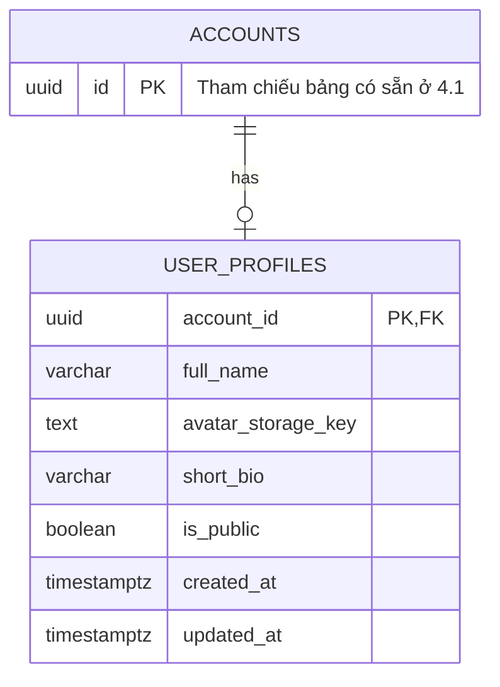

# ERD 4.2 — Quản lý hồ sơ người dùng và bảng điều khiển

Nguồn: [SRS ver 1.1](../SRS%20ver%201.1.docx), mục 4.2 (`FR-PRO-001`–`FR-PRO-005`), `BR-PRO-001`, `BR-PRO-002`, `BR-DATA-001` và `BR-PPRC-003`, `BR-PPRC-006`–`BR-PPRC-008`. Thiết kế logic cho PostgreSQL 16, nối tiếp [account-auth 4.1](ERD-4.1-account-auth.md). Bản DBML tương ứng: [ERD-4.2-user-profile.dbml](ERD-4.2-user-profile.dbml).

Chỉ bổ sung bảng `user_profiles`. Các bảng của 4.1 được giữ nguyên; Dashboard là dữ liệu truy vấn/tổng hợp từ các phân hệ, không tạo bảng sao chép dữ liệu học tập hay bảng đếm riêng trong 4.2. Đây là tài liệu thiết kế, chưa triển khai migration.

## Phân định dữ liệu với account-auth

| Thông tin trong mục 4.2 | Nguồn dữ liệu duy nhất | Cách sử dụng |
| :--- | :--- | :--- |
| Username, Email | `accounts.username`, `accounts.email` | JOIN khi xem hồ sơ cá nhân; không lưu lại trong hồ sơ |
| Role | `accounts.role` | Phân quyền và chọn Dashboard; không cho sửa qua hồ sơ |
| Join Date | `accounts.created_at` | Ngày tham gia hệ thống; không lấy ngày tạo bản ghi hồ sơ |
| Trạng thái tài khoản | `accounts.lifecycle_status` và `account_restrictions` | Tính quyền truy cập và khả năng hiển thị công khai tại thời điểm đọc |
| Mật khẩu, OTP, phiên đăng nhập | Các bảng 4.1 | Không thuộc dữ liệu hồ sơ và không trả trong DTO hồ sơ |
| Họ tên, Avatar, Bio, thiết lập công khai | `user_profiles` | Dữ liệu bổ sung của 4.2 |
| Solved và Streak | Public Practice 4.12 và Official Submission 4.9 | Tổng hợp theo tài khoản; không lưu bản sao trong hồ sơ |

`accounts` trong DBML chỉ là stub chứa khóa chính để sơ đồ có thể mở độc lập. Khi hợp nhất ERD, bỏ stub này và giữ nguyên bảng `accounts` đầy đủ của 4.1; không chạy DDL tạo lại bảng. Sơ đồ không khai báo lại `account_restrictions`, `auth_sessions`, `otp_challenges` hoặc `audit_logs`.

## Từ điển dữ liệu `user_profiles`

| Cột | Kiểu | Ràng buộc / mặc định | Ý nghĩa |
| :--- | :--- | :--- | :--- |
| `account_id` | `uuid` | PK, FK → `accounts.id`, NOT NULL | Dùng chung khóa tài khoản, không sinh UUID mới |
| `full_name` | `varchar(150)` | NULL được phép | Họ và tên; không yêu cầu duy nhất |
| `avatar_storage_key` | `text` | NULL được phép | Khóa đối tượng do File Storage Service trả về sau khi upload thành công |
| `short_bio` | `varchar(500)` | NULL được phép | Tiểu sử ngắn dạng văn bản thuần |
| `is_public` | `boolean` | NOT NULL, mặc định `false` | Lựa chọn công khai hồ sơ của chủ tài khoản |
| `created_at` | `timestamptz` | NOT NULL, mặc định `now()` | Thời điểm tạo hồ sơ, không phải Join Date |
| `updated_at` | `timestamptz` | NOT NULL, mặc định `now()` | Thời điểm cập nhật hồ sơ gần nhất |

Giới hạn ứng dụng 150 ký tự cho họ tên và 200 ký tự cho bio; cột `varchar(500)` giữ khả năng đọc dữ liệu cũ mà không cắt nội dung. Việc cho phép NULL và mặc định riêng tư là **đề xuất thiết kế**, vì mục 4.2 chưa quy định cụ thể. Chuỗi tùy chọn sau khi trim nếu rỗng được chuẩn hóa thành NULL. Không tự đặt giới hạn dung lượng/loại tệp avatar: lấy cấu hình Admin theo `BR-DATA-001`.

## Quy tắc thiết kế

- Quan hệ vật lý là một tài khoản có tối đa một hồ sơ; PK đồng thời FK ngăn hồ sơ trùng và hồ sơ mồ côi. Ứng dụng tạo hồ sơ cho Student/Teacher trong cùng transaction tạo tài khoản; khi triển khai trên dữ liệu cũ phải backfill. Admin không có chức năng quản lý hồ sơ theo `FR-PRO-001`/`002`; kiểm soát vai trò tại Service, không suy ra quyền chỉ từ việc có bản ghi hồ sơ.
- `account_id` đã có chỉ mục do PK, không thêm index FK trùng lặp. Truy cập hồ sơ công khai theo `accounts.username` dùng unique index có sẵn của 4.1. MVP không cần index riêng trên boolean `is_public`.
- FK dùng `ON DELETE RESTRICT`, nhất quán với 4.1. Vô hiệu hóa hoặc đình chỉ tài khoản không xóa hồ sơ, không sao chép trạng thái sang hồ sơ và không thay đổi lựa chọn `is_public` đã lưu.
- Hồ sơ công khai chỉ được đọc khi `is_public = true`, tài khoản Student/Teacher có `lifecycle_status = ACTIVE` và không có `SUSPENSION` đang hiệu lực. Hạn chế đang hiệu lực được kiểm tra từ `starts_at`, `ends_at`, `revoked_at` theo 4.1, không chỉ kiểm tra sự tồn tại của hàng. Tài khoản Suspended hoặc Deactivated luôn bị ẩn (`BR-PRO-002`). Chính sách với `AUTO_LOCK`/`ADMIN_LOCK` cần theo quy tắc truy cập của 4.1; không tự đồng nhất mọi loại khóa với đình chỉ.
- DTO công khai dùng danh sách trường cho phép: **Username, Avatar, Bio, Solved, Streak**. Không công khai Full Name, Email, Role, Join Date, ID nội bộ, khóa lưu trữ thô, điểm hay bài nộp riêng tư. DTO xem hồ sơ của chính mình được kết hợp các trường theo `FR-PRO-001` từ những nguồn ở bảng trên.
- Student/Teacher chỉ cập nhật hồ sơ của chính mình; lấy `account_id` từ principal đã xác thực. Chỉ nhận các trường `full_name`, avatar hợp lệ, `short_bio`, `is_public`; từ chối yêu cầu thay đổi Username, Email, Role, ID hoặc các trường do hệ thống quản lý. JOIN đúng tài khoản không thay thế kiểm tra quyền tại Service.
- Avatar được File Storage Service kiểm tra quyền sở hữu, loại tệp thực tế, dung lượng và yêu cầu bảo mật trước khi gắn khóa vào hồ sơ. Khóa lưu trữ là tham chiếu dịch vụ, không phải FK tới một bảng chưa được định nghĩa. Không lưu bản sao binary, URL tùy ý từ client hoặc URL ký có hạn; tạo URL đọc theo chính sách truy cập khi trả DTO. Schema metadata tệp dùng chung thuộc phạm vi File Storage theo `BR-DATA-001`.
- Upload hoặc validation thất bại giữ nguyên hồ sơ và avatar cũ (`FR-PRO-001/AC-05`). Chỉ cập nhật con trỏ avatar trong transaction sau khi upload thành công; dọn đối tượng upload mồ côi nếu ghi DB thất bại, dọn avatar cũ sau commit khi không còn được dùng. Không xóa avatar cũ trước khi thay thế thành công.
- `created_at`, `updated_at` lưu thời điểm UTC với `TIMESTAMPTZ`; `updated_at` phải được cập nhật bởi JPA Auditing khi thay đổi, vì default `now()` chỉ áp dụng khi INSERT. API serialize ISO-8601 UTC kết thúc `Z`; frontend hiển thị UTC+7.

## Dữ liệu Dashboard và thống kê

ERD chung cho Dashboard Student, Teacher và Admin theo `FR-PRO-003`, `FR-PRO-004`, `FR-PRO-005`: [tài liệu và sơ đồ quan hệ](ERD-4.2-user-dashboard.md), [DBML](ERD-4.2-user-dashboard.dbml). ERD này thể hiện các bảng nguồn dưới dạng đề xuất logic, không tạo thêm bảng trùng với phân hệ sở hữu.

Các tên nguồn dưới đây là phân hệ nghiệp vụ, **không phải khai báo các bảng đã tồn tại**. Tên bảng/khóa/index cụ thể sẽ theo ERD của từng phân hệ. Truy vấn phải áp dụng quyền trước khi tổng hợp, kể cả khi trả số lượng hoặc đi qua liên kết điều hướng.

| Yêu cầu | Nhóm dữ liệu | Nguồn và phạm vi |
| :--- | :--- | :--- |
| `FR-PRO-003` — Student | Class đang tham gia; Assignment/Quiz sắp tới | 4.3, 4.6, 4.7; chỉ Class có quyền truy cập, áp dụng deadline/gia hạn tương ứng |
| `FR-PRO-003` — Student | Public Course đang học | 4.11; đăng ký và tiến độ của chính tài khoản |
| `FR-PRO-001`, `003` | Public Practice Statistics, Solved, Streak | 4.12, 4.9; chỉ dữ liệu của tài khoản mục tiêu theo quyền xem hồ sơ |
| `FR-PRO-003`, `004` | Notification mới nhất | 4.13; chỉ thông báo của người đang đăng nhập |
| `FR-PRO-004` — Teacher | Class quản lý, Assignment đang mở/sắp tới, bài chưa chấm, Submission mới, thống kê Class | 4.3, 4.6–4.10; chỉ Class đang sở hữu/quản lý hợp lệ, không lấy dữ liệu Class của Teacher khác |
| `FR-PRO-004` — Teacher | Nội dung Public đóng góp chờ duyệt | 4.11, 4.12, 4.14; lọc theo Teacher đóng góp và trạng thái duyệt |
| `FR-PRO-005` — Admin | Tổng Student, Teacher; tài khoản khóa/vi phạm | 4.1 và 4.14; đếm tài khoản theo Role, tổng hợp hạn chế mà không nhân bản tài khoản khi JOIN nhiều hạn chế |
| `FR-PRO-005` — Admin | Tổng Class, Public Course, Public Problem, Submission; đóng góp chờ duyệt | 4.3, 4.9, 4.11, 4.12, 4.14; xác định rõ bộ lọc trạng thái/phạm vi thống kê |
| `FR-PRO-005` — Admin | Hoạt động gần đây, sự kiện Audit quan trọng, biểu đồ thời gian | 4.14–4.16 và dữ liệu sự kiện của phân hệ nguồn; chỉ quyền quản trị phù hợp |
| `FR-PRO-005` — Admin | Lối tắt cấu hình hệ thống | 4.14; điều hướng có kiểm tra quyền, không cần bảng trong 4.2 |

Solved đếm **số Public Problem phân biệt** có ít nhất một Official Submission `ACCEPTED` (`BR-PPRC-003`), không đếm số lần Accepted. Streak chỉ tính Public Practice, không tính RUN, Class Practice hay Assignment (`BR-PPRC-006`). Ngày hợp lệ có ít nhất một Official Submission Accepted và được xác định theo UTC+7 (`BR-PPRC-007`), dù timestamp nguồn vẫn lưu UTC. Bỏ lỡ một ngày reset Current Streak, Highest Streak được giữ (`BR-PPRC-008`). Các phép tính này thuộc 4.12, 4.2 chỉ tiêu thụ kết quả.

Không bổ sung bảng Calendar trong MVP. Không tạo bảng Dashboard, bộ đếm Solved/Streak hay snapshot trạng thái tài khoản trong hồ sơ. Nếu cần cache khi triển khai, phải có cơ chế vô hiệu hóa khi đổi quyền riêng tư, đình chỉ/vô hiệu hóa hoặc thay đổi dữ liệu nguồn; không dùng cache để bỏ qua kiểm tra quyền hiện hành.

## Đối chiếu tiêu chí chấp nhận

| Tiêu chí SRS | Cách đáp ứng / tình huống cần kiểm chứng khi triển khai |
| :--- | :--- |
| `FR-PRO-001/AC-01`–`AC-04` | JOIN hồ sơ với tài khoản; sửa họ tên/avatar/bio hợp lệ rồi đọc lại; từ chối sửa định danh và vai trò |
| `FR-PRO-001/AC-05`–`AC-06` | Upload/validation lỗi không thay đổi dữ liệu cũ; tài khoản khác không đọc/sửa thông tin riêng tư |
| `FR-PRO-002/AC-01`–`AC-04`, `AC-06`–`AC-07` | Lưu bật/tắt công khai; chỉ chủ tài khoản sửa được; DTO công khai đúng danh sách trường cho phép |
| `FR-PRO-002/AC-05` | Bật công khai rồi đình chỉ/vô hiệu hóa: hồ sơ phải ẩn; hạn chế hết hạn/được thu hồi được đánh giá đúng |
| `FR-PRO-003/AC-01`–`AC-07` | Dashboard Student đủ nhóm dữ liệu, chỉ dữ liệu được phép; không bắt buộc Calendar |
| `FR-PRO-004/AC-01`–`AC-07` | Dashboard Teacher chỉ tổng hợp Class sở hữu, nội dung và Notification tương ứng; đích điều hướng tiếp tục kiểm tra quyền |
| `FR-PRO-005/AC-01`–`AC-08` | Chỉ Admin truy cập; thống kê đủ nhóm, đúng phạm vi; Audit/cấu hình có quyền tương ứng; biểu đồ lấy dữ liệu nguồn |

Đây là ma trận truy vết thiết kế và các tình huống kiểm chứng cho bước triển khai, chưa phải kết quả chạy kiểm thử chức năng.
