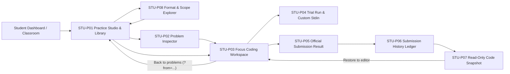

# FE 4.8 & 4.12 · Student Coding Practice ("The Algorithm Studio")

## Directory refinement

The Practice directory now leads with enrolled classrooms as flat, full-row links. The oversized featured panel and format/source explorer were removed. A recent draft remains accessible as a compact link. The class library has a visible **All Classrooms** action that points to `/practice`, so direct links and refreshes retain a reliable return path. Public catalog has its own heading and source tab; problem workspace return links keep the originating URL and query string.

| Navigation check | Result |
|---|---|
| Direct class library URL or refresh | **All Classrooms** remains visible |
| Empty/error class library | Header return action remains outside data state |
| Class problem → workspace → back | Restores the class library and filter query |
| Public problem → workspace → back | Restores `/practice?scope=public` |

Before/after visual review: [library before](practice-library-before.png), [directory after](practice-directory-after.png), [class library after](practice-class-library-after.png), [mobile directory after](practice-directory-mobile-after.png), [public catalog after](practice-public-catalog-after.png). Screenshots use development fixtures, as indicated by the visible banner. The frontend API contracts remain unchanged. Classroom pagination is backed by the existing `GET /classrooms` page parameter; filtering of problems still applies to the current backend page because no server-side search contract exists.

## 1. Sources of Truth & Scope

- **Repository SRS:** `docs/SRS ver 1.1.docx` — Section `4.8` (*Class Practice Problems*) and Section `4.12` (*Public Practice*).
- **Screen Specification:** The linked Google Doc was inaccessible through the available tool. The pasted task text, repository SRS, existing UI, and verified API contracts were used.
- **Backend Contracts Verified:**
  - `PracticeController.java` & `PracticeDtos.java` (`/api/v1/classrooms/{classroomId}/practices/*`)
  - `ProblemController.java` & `ProblemService.java` (`/api/v1/problems/*`)
- **Design Direction:** *Technical Editorial Minimalism* — preserving AlgoLearn's off-white (`#F5F5F3` / `#FAFAF9`) and charcoal (`#18191B` / `#1B1C1F`) visual identity while drawing structural patterns from Vercel Geist, Linear, Raycast, Zed, Exercism, Warp, and GitHub.

---

## 2. SRS Requirements Traceability Matrix

| Requirement ID | Screen | User action | Required data | UI component | API dependency | Verification status |
|---|---|---|---|---|---|---|
| `FR-PRC-001` (AC-04–07) | Focus Coding Workspace (`STU-P03`), Execution Console (`STU-P04`) | Select `JAVA` or `PYTHON`, edit code, run trial execution (`RUN`), or submit repeatedly (`SUBMIT`) | `allowedLanguages`, `starterCode`, `sampleTestcases`, `timeLimitMs`, `memoryLimitMb`, `verdict` | `PracticeWorkspacePage`, Monaco Editor (`@monaco-editor/react`), `ExecutionConsole` | `POST /api/v1/classrooms/{id}/practices/{practiceId}/run`, `POST .../submit` | Verified (`typecheck`, unit, Playwright E2E) |
| `FR-PRC-002` (AC-02–04, 07, 09–10) | Practice Studio & Library (`STU-P01`), Problem Inspector (`STU-P02`) | Browse enrolled classrooms, inspect published problems, respect `available=false` read-only state | `classroomId`, `title`, `problemType`, `status=PUBLISHED`, `available`, `description`, `sampleTestcases` | `PracticeStudioPage`, `ProblemInspector`, `PracticeWorkspacePage` | `GET /api/v1/classrooms`, `GET /api/v1/classrooms/{id}/practices`, `GET .../practices/{practiceId}` | Verified (`typecheck`, Playwright E2E) |
| `FR-PRC-003` (AC-01–04, 08–10) | Practice Library (`STU-P01`), Submission Result (`STU-P05`) | Observe `Completed` state upon first `ACCEPTED` official submission (`RUN` never marks completed; ungraded, no deadline) | `completionStatus` (`COMPLETED` / `NOT_COMPLETED`), `verdict` | Status pill (`✓ Completed`), `ExecutionConsole` submission banner | `POST .../submit` + TanStack Query invalidation of `practiceKeys` | Verified (`typecheck`, Playwright E2E) |
| `FR-PRC-004` (AC-01–05, 08–12) | Submission History (`STU-P06`), Submission Detail (`STU-P07`) | Review chronological own submissions, filter by verdict/language, inspect read-only historical source code, restore to editor | `id`, `language`, `code`, `verdict`, `testsPassed`, `totalTests`, `runtimeMs`, `memoryKb`, `testcaseVersion`, `rejudgeStatus`, `submittedAt` | `SubmissionHistoryPanel` (Execution Ledger + Read-only Code Snapshot) | `GET .../submissions/me`, `GET .../submissions/{submissionId}` | Verified (`typecheck`, unit, Playwright E2E) |
| `FR-PRAC-001` & `FR-PRAC-002` | Public Catalog tab (`STU-P01`), Inspector (`STU-P02`), Workspace (`STU-P03`) | Browse published public problems and open statement + sample cases | `id`, `title`, `statement`, `languages`, `samples`, `limits` | `PracticeStudioPage` (`scope=public`), `ProblemInspector`, `PracticeWorkspacePage` (`/practice/problems/:practiceId`) | `GET /api/v1/problems`, `GET /api/v1/problems/{id}` | Verified (`typecheck`, build, offline fixture) |
| `FR-PRAC-003` & `FR-PRAC-004` | Public Workspace (`STU-P03`–`P06`) | Run or submit against public problems with async job polling and view own public submission records | `jobId`, `verdict`, `passed`, `total`, `cases`, `submissionId`, `submittedAt` | `PracticeWorkspacePage` (`pollPublicEvaluation`), `SubmissionHistoryPanel` | `POST /api/v1/problems/{id}/run`, `POST .../submissions`, `GET .../jobs/{job}`, `GET .../submissions` | Verified (`typecheck`, build) |
| `BR-JDG-005..007` & `BR-SEC-001..004` | Workspace & Execution Console (`STU-P03`–`P05`) | Distinguish trial `RUN` from official `SUBMIT`; enforce `<= 64 KB` custom stdin; handle `429` rate limit, `409` testcase update, and `503` Judge outage without blaming student code | `customInput` byte length, HTTP `429`/`409`/`503` `ApiErrorResponse`, sanitized Markdown | `classifyPracticeError`, `validateCustomInputBytes`, `MarkdownRenderer`, `purgeOtherUserDrafts` on logout | Backend Judge boundary & `UNAUTHORIZED_EVENT` | Verified (`typecheck`, unit, Playwright E2E) |
| `NFR-LOC-001` & `NFR-ACCESS-001` | All Student Practice screens | Display timestamps in `Asia/Ho_Chi_Minh` (`UTC+7`); keyboard-accessible splitters, `Esc` inspector close with focus return, non-color verdict symbols | ISO UTC strings, ARIA `tablist`/`separator`/`alert` roles | `practiceFormatters.ts`, `PracticeStudioPage`, `PracticeWorkspacePage` | Client localization & WCAG 2.2 AA semantics | Verified (unit + `@axe-core/playwright`) |

### Classification of Capabilities

- **Mandatory SRS Requirements Implemented:** Enrolled classroom practice library, problem statement + sample I/O rendering, Java 21 & Python 3 Monaco workspace, distinct `RUN` (sample/custom stdin, unrecorded) vs `SUBMIT` (official verdict, marks `COMPLETED` on `ACCEPTED`), own submission history & read-only source detail, public problem catalog integration, `UTC+7` formatting, and `429`/`409`/`503` error handling.
- **UX Improvements & Creative Enhancements:**
  - *Continue Practicing* charcoal studio band surfacing the student's latest unfinished local draft (scoped per `userId + scope + classroomId + problemId + language`, purged on logout) with restrained monochrome SVG algorithm graphics (`AlgorithmGraphic`).
  - Raycast-inspired contextual *Problem Inspector* (`STU-P02`) with `Esc` close and focus restoration.
  - Preserved URL filter/search context (`?from=...`) when moving between Library and Workspace.
  - Stale execution notice when code is edited after a `RUN` or `SUBMIT`, inline accessible confirmations for *Reset* and *Restore to editor* (zero `window.confirm`), and keyboard-operable splitters (`ArrowLeft`/`ArrowRight`, `ArrowUp`/`ArrowDown`).
- **Features Requiring Additional Backend Support (Not Faked):**
  - Problem `difficulty` (`Easy`/`Medium`/`Hard`), curriculum `tags`/`topics`, `acceptance rate`, `bookmarked/saved` server sync, `official editorial`, `report problem`, and historical source code retrieval on SRS `4.12` public submissions (`GET /api/v1/problems/{id}/submissions` currently returns metadata only, whereas SRS `4.8` classroom submissions return full `code`, `runtimeMs`, and `memoryKb`).

---

## 3. Verified Screen Inventory & User Flow

| Screen Code | Screen Name | Route / Surface | Implementation |
|---|---|---|---|
| `STU-P01` | Practice Studio & Problem Library | `/practice`, `/student/classrooms/:id/practice` | `PracticeStudioPage.tsx` |
| `STU-P02` | Problem Inspector (Quick Preview) | Contextual right drawer inside `STU-P01` | `ProblemInspector.tsx` |
| `STU-P03` | Dedicated Coding Workspace ("The Focus Studio") | `/student/classrooms/:id/practice/:practiceId`, `/practice/problems/:practiceId` | `PracticeWorkspacePage.tsx` |
| `STU-P04` | Execution Inspector (Trial Run & Custom Stdin) | Bottom-right console (`Test cases` / `Execution result`) | `ExecutionConsole.tsx` |
| `STU-P05` | Formal Submission Result | Elevated verdict & metrics card inside `ExecutionConsole` | `ExecutionConsole.tsx` |
| `STU-P06` | Submission History ("Execution Ledger") | Chronological `TODAY`/`YESTERDAY` grouped ledger tab | `SubmissionHistoryPanel.tsx` |
| `STU-P07` | Submission Detail ("Code Review Inspector") | Read-only line-numbered source snapshot + restore action | `SubmissionHistoryPanel.tsx` |
| `STU-P08` | Format & Scope Explorer | Editorial filter rail integrated into `STU-P01` top band | `PracticeStudioPage.tsx` |

### Reference Pattern Mapping

- **Vercel Geist:** High-contrast monochrome surfaces, hairline `1px` dividers, tabular monospace metrics, deployment-style submission result card.
- **Linear:** Flat high-density problem rows, inline segmented status filters, zero card-grid clutter.
- **Raycast:** Master-detail Problem Inspector (`Preview` / `Esc`) and `Ctrl+K` instant search focus.
- **Zed & Exercism:** Distraction-free full-viewport coding studio (`100dvh`), dark `#1B1C1F` editor surface paired with warm off-white `#FAFAF9` reading surface.
- **Warp & GitHub:** Case pill selector strip, side-by-side `Input` / `Expected` / `Actual` diff blocks, chronological day-grouped submission ledger, and line-numbered read-only historical code view.

---

## 4. Responsive Screen Architecture

| Viewport | Studio & Library (`STU-P01`, `P02`, `P08`) | Coding Workspace (`STU-P03`–`P07`) |
|---|---|---|
| `1920×1080` / `1440×900` | Centered `1380px` max-width editorial canvas; flat classroom directory with compact resume link; side-by-side sticky `410px` Problem Inspector | Full-viewport split studio (`Split` / `Focus` / `Console` modes) with resizable horizontal & vertical splitters |
| `1280×720` / `1024×768` | Compact table columns; Problem Inspector transitions below `1120px` to a slide-over sheet (`max-width: 440px`) | Resizable 2-column split maintained down to `768px` with compact topbar controls |
| `768×1024` | Single-column directory rows; full-width problem table + slide-over Inspector | Compact split or `Focus`/`Console` toggle; zero horizontal overflow |
| `390×844` | Secondary columns (`Format`, `Limits`) hidden cleanly; stacked header & filters | Single-column task switcher (`Description \| Code \| Tests \| History`) preserving Monaco state across switches + sticky bottom `[ Run Code ] [ Submit ]` bar |
